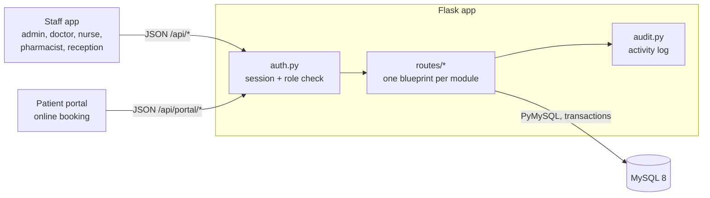
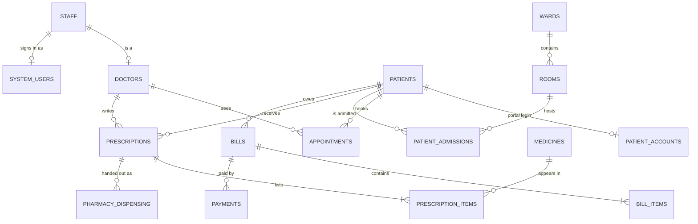

# MediCore HMS

[](https://github.com/shashankmishra23/medicore-hospital-management/actions/workflows/ci.yml)


[](https://docs.astral.sh/ruff/)
[](LICENSE)

A hospital management system built with **Flask** and **MySQL**, with two front ends:

- a **staff app** where admins, doctors, nurses, pharmacists and receptionists each sign in with their own role and only see the parts of the hospital they work in, and
- a **patient portal** where patients sign up, book appointments online and see their own prescriptions and bills.

The hospital's name, address and phone number are settings, so the same code can be deployed for any hospital.


**Contents:** [Features](#features) · [Screenshots](#screenshots) · [Architecture](#architecture) · [Quick start](#quick-start) · [Signing in](#signing-in) · [API](#api-overview) · [Design decisions](#design-decisions) · [Tests](#tests-and-ci)

## Features

**Staff app**

- **Role-based access.** Staff choose their role and type their name. Each role gets its own menu *and* its own data: a pharmacist can't open billing and a doctor doesn't see revenue. The API enforces this; it is not just hidden in the UI.
- **Patients.** Register, edit, search by name, phone or ID, and open a full patient file with allergies, history, admissions, prescriptions and bills.
- **Appointments.** Book from the doctor's free 30-minute slots, with checks for working days, past dates and double-booking. Online bookings are flagged for reception.
- **Admissions.** Admit to a free room and discharge. Ward bed counts update automatically, and the discharge bill (room days, doctor's fee, medicines given during the stay) is created for you.
- **Prescriptions and pharmacy.** Doctors prescribe, the pharmacy dispenses, and stock goes down. Expired or out-of-stock medicine can't be dispensed. Low-stock and expiry alerts.
- **Billing.** Itemised bills with discount and tax, part payments, overdue tracking and printable receipts.
- **Dashboard.** Live numbers and charts (revenue, appointments, bed occupancy), filtered to what each role may see.
- **Settings (admin).** One switch for whether sign-in needs a password, plus every staff and patient account in one place: create accounts, set passwords, turn accounts off.
- **Activity log (admin).** Every sign-in and change, with who did it, when and from where.

**Patient portal**

- Sign up online, or get an account from the hospital if you already have a record there.
- Book in four steps: doctor → day → free time slot → reason. Cancel upcoming visits.
- See and print prescriptions, view bills and receipts, keep contact details and allergies up to date.

**Also:** light and dark theme, works on phones, every form validated on both the page and the server.

## Screenshots

| Sign in | Patient portal |
|---|---|
|  |  |
| **Online booking** | **Appointments (staff)** |
|  |  |
| **Patient file** | **Activity log** |
|  |  |
| **Settings: passwords and accounts** | **Wards & rooms** |
|  |  |

## Architecture



Both front ends are server-rendered pages with plain JavaScript that talk to a JSON API. Every request passes through one login and permission check before it reaches a route.

**Main tables** (20 tables and 4 views in total, see [`database/schema.sql`](database/schema.sql)):



## Quick start

### With Docker (easiest)

```bash
git clone https://github.com/shashankmishra23/medicore-hospital-management.git
cd medicore-hospital-management
docker compose up --build
```

Open http://localhost:5000. MySQL starts with the sample data already loaded.

### Without Docker

You need Python 3.10+ and MySQL 8.

```bash
git clone https://github.com/shashankmishra23/medicore-hospital-management.git
cd medicore-hospital-management
python -m venv .venv
.venv\Scripts\activate            # macOS / Linux: source .venv/bin/activate
pip install -r requirements.txt
```

Copy `.env.example` to `.env` and set at least `DB_PASSWORD` and `SECRET_KEY`. The `HOSPITAL_*` values change the name and contact details shown in the app. Then:

```bash
flask init-db       # creates hospital_db with sample data (drops it first if it exists)
python app.py
```

Open http://127.0.0.1:5000.

## Signing in

Choose a role on the login page and type the person's **name** (full name, or just the first name). If passwords are switched on in Settings, also type the password.

| Role | Name | Password |
|---|---|---|
| Admin | Shashank Mishra | `admin123` |
| Doctor | Arun Sharma | `doctor123` |
| Nurse | Sunita Singh | `nurse123` |
| Pharmacist | Mohit Jain | `pharma123` |
| Receptionist | Kavita Rao | `reception123` |
| Patient (portal) | `anita.p@email.com` | `patient123` |

These are sample accounts for trying the app. Change them before real use.

**Settings (admin only).** Everything about signing in lives on one page:

- **Ask for a password when signing in.** On by default. Switch it off and the login pages ask only for a name (staff) or email (patients), which is handy for demos or a closed network.
- **Staff accounts.** Create an account for any staff member, choose which role they sign in as, set or change their password, or turn the account off. Setting a password also unlocks an account locked after wrong attempts.
- **Patient portal accounts.** Create an account for an existing patient after checking their ID, set the password, or turn it off.

### What each role can do

| | Admin | Doctor | Nurse | Pharmacist | Receptionist |
|---|:-:|:-:|:-:|:-:|:-:|
| Patients | edit | edit | edit | view | edit |
| Appointments | edit | edit | view | | edit |
| Admissions | edit | edit | edit | | view |
| Prescriptions | edit | write | view | dispense | |
| Pharmacy stock | edit | view | | edit | |
| Billing | edit | | | | edit |
| Wards & rooms | edit | view | edit | | view |
| Staff | edit | | | | view |
| Settings & accounts | edit | | | | |
| Activity log | view | | | | |

## API overview

All endpoints return JSON. Staff endpoints are under `/api` and need a staff session; patient endpoints are under `/api/portal` and need a patient session. Writes also check the user's role.

| Method | Endpoint | Purpose |
|---|---|---|
| `POST` | `/api/auth/login`, `/api/auth/logout` | Staff sign in / out |
| `GET` | `/api/dashboard`, `/api/dashboard/charts`, `/api/alerts` | Dashboard numbers, charts, alerts |
| `GET` `POST` | `/api/patients` | Search, register |
| `GET` `PUT` | `/api/patients/<id>` | Patient file, edit |
| `GET` `POST` | `/api/appointments` | List and filter, book |
| `GET` | `/api/appointments/slots` | Free slots for a doctor and day |
| `GET` `POST` | `/api/admissions` | List, admit |
| `POST` | `/api/admissions/<id>/discharge` | Discharge, optionally create the bill |
| `GET` `POST` | `/api/prescriptions` | List, write |
| `POST` | `/api/prescriptions/<id>/dispense` | Dispense and reduce stock |
| `GET` `POST` | `/api/medicines` | Stock, add medicine |
| `GET` `POST` | `/api/bills`, `POST /api/payments` | Bills and payments |
| `GET` `PUT` | `/api/settings`, `/api/settings/accounts` | Sign-in setting and accounts (admin) |
| `POST` | `/api/portal/register`, `/api/portal/login` | Patient sign up / sign in |
| `GET` `POST` | `/api/portal/slots`, `/api/portal/appointments` | Online booking |
| `GET` | `/health` | Health check for Docker and uptime monitors |

## Design decisions

A few choices worth explaining:

- **Permissions live on the server.** Each route declares what it needs (`@requires("billing.write")`), and a single `PERMISSIONS` table maps roles to actions. The UI hides what you can't use, but the API is what actually refuses.
- **Row locking for shared resources.** Admitting a patient, dispensing medicine and taking a payment all run in a transaction with `SELECT … FOR UPDATE`, so two people can't take the same bed, the same stock or overpay the same bill at the same time.
- **The server does the maths.** Bill totals, tax and discounts are calculated server-side from the line items; the page's own totals are only a preview.
- **Safe by default in the browser.** All page content is built with a small tagged-template helper (`` html`…` ``) that escapes every value, so patient names and notes can't inject scripts.
- **Patients can't take over records.** Online sign-up always creates a new record. Linking a portal account to an existing hospital record is done by an admin after an ID check, so knowing someone's phone number and birthday isn't enough.
- **One connection per request.** Connections are opened on first use and closed when the request ends, and writes go through a `transaction()` helper that commits or rolls back as a unit.
- **Everything is audited.** Sign-ins and every change are written to an activity log with the user, role and IP address.

## Tests and CI

```bash
pip install -r requirements-dev.txt
ruff check .
pytest
```

The 40 tests run against a real MySQL database (`hospital_db_test`, created and removed by the tests). They cover sign-in and lockout, role permissions, the password switch, booking rules, bed counts on admit/discharge, discharge bills, stock changes when dispensing, bill totals and payments, and patient data isolation.

GitHub Actions runs three jobs on every push and pull request: **lint** (ruff), **tests** (pytest against MySQL 8) and **Docker** (builds the image, starts the stack and checks `/health`).

## Project layout

```
app.py               app factory, /health, CLI commands (init-db, create-user)
config.py            settings from .env, including hospital branding
auth.py              sign-in, roles and permissions, password checks, lockout
audit.py             activity log
db.py, utils.py      database helpers, input validation, error handling
routes/              JSON API, one blueprint per module (patients, portal, settings, ...)
templates/           login.html, index.html (staff app), portal.html (patients)
static/js/           core.js (shared helpers) plus one file per page
static/css/          styles, dark and light theme
database/schema.sql  tables, views and sample data
tests/               pytest suite
Dockerfile, docker-compose.yml
```

## Roadmap

- Email or SMS reminders for upcoming appointments
- Online payment for bills
- Lab test orders and results
- Export reports to PDF and Excel

## Contributing

Issues and pull requests are welcome. See [CONTRIBUTING.md](CONTRIBUTING.md).

## License

[MIT](LICENSE) © 2026 [Shashank Mishra](https://github.com/shashankmishra23)
