<div align="center">

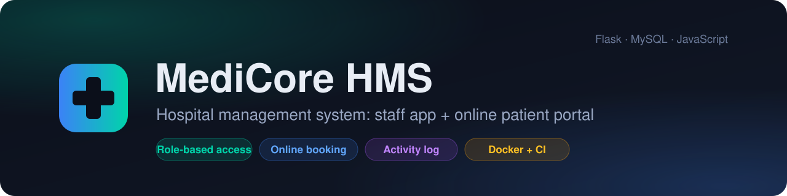

<br>

**A full-stack hospital management system with a role-based staff app and an online patient portal.**<br>
Built with Flask and MySQL, tested in CI, and runnable with one Docker command.

<br>

[](https://github.com/shashankmishra23/medicore-hospital-management/actions/workflows/ci.yml)
[](https://github.com/shashankmishra23/medicore-hospital-management/releases)


[](https://docs.astral.sh/ruff/)
[](LICENSE)

[**Quick start**](#quick-start) ·
[**Features**](#features) ·
[**Screenshots**](#screenshots) ·
[**Architecture**](#architecture) ·
[**Design decisions**](#design-decisions) ·
[**API**](#api-reference)

<br>

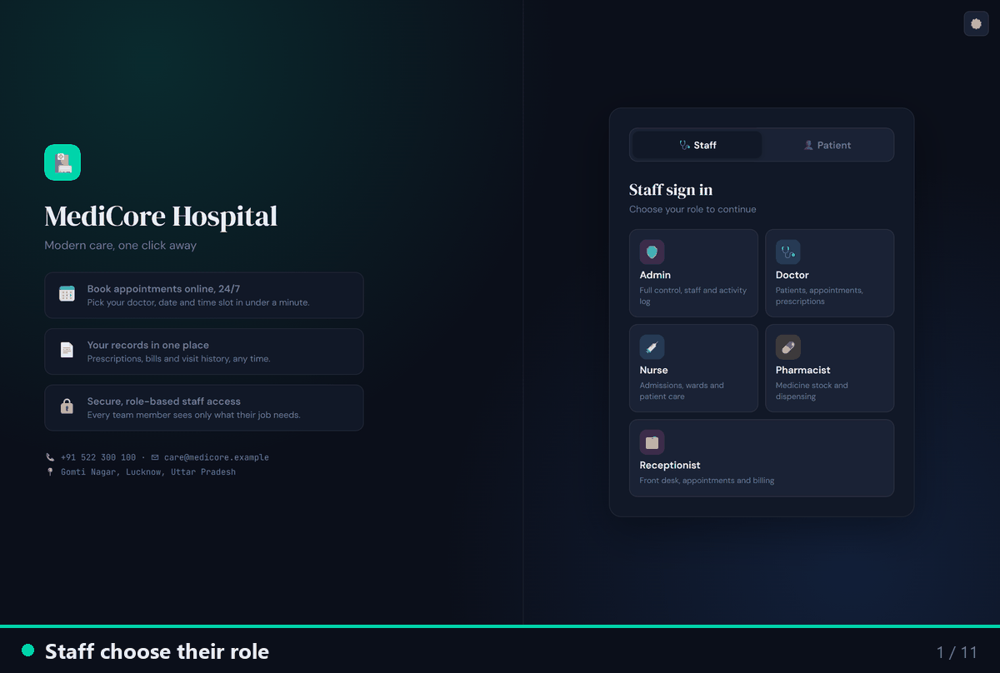

</div>

<br>

## At a glance

<table>
  <tr>
    <td align="center" width="20%"><h3>5 + 1</h3>staff roles<br>+ patient portal</td>
    <td align="center" width="20%"><h3>57</h3>JSON API<br>endpoints</td>
    <td align="center" width="20%"><h3>20</h3>MySQL tables<br>+ 4 views</td>
    <td align="center" width="20%"><h3>40</h3>automated tests<br>on real MySQL</td>
    <td align="center" width="20%"><h3>3</h3>CI jobs on every<br>push and PR</td>
  </tr>
</table>

## Features

<table>
<tr>
<td width="50%" valign="top">

### Staff app

- **Role-based access.** Admin, Doctor, Nurse, Pharmacist and Receptionist each get their own menu and data. The API enforces it; it's not just hidden in the UI.
- **Patients.** Register, search by name, phone or ID, and open a full file with allergies, history, admissions, prescriptions and bills.
- **Appointments** from the doctor's free 30-minute slots, with checks for working days, past dates and double-booking.
- **Admissions.** Admit to a free room, discharge, and get the bill created automatically.
- **Prescriptions and pharmacy.** Prescribe, dispense, and stock goes down. Expired or out-of-stock medicine is refused.
- **Billing** with discounts, tax, part payments and printable receipts.
- **Dashboard** with live charts and an alerts bell, filtered by role.

</td>
<td width="50%" valign="top">

### Patient portal

- **Sign up online** and book in four steps: doctor → day → free time → reason.
- **Cancel** upcoming visits so the slot frees up for someone else.
- **Records.** See and print prescriptions, view bills and receipts.
- **Profile.** Keep contact details, emergency contact and allergies up to date.

### Admin and security

- **Settings page.** Switch password sign-in on or off, and create, update or turn off any staff or patient account.
- **Activity log** of every sign-in and change, with who, when and from where.
- **Account lockout** after 5 wrong passwords, salted password hashes, escaped output and JSON-only writes.
- **Rebrand in one place.** Hospital name, address and phone come from settings.

</td>
</tr>
</table>

## Screenshots

> [!TIP]
> Click any section to expand it.

<details open>
<summary><b>Staff app</b></summary>
<br>

| Dashboard | Patient file |
|---|---|
| 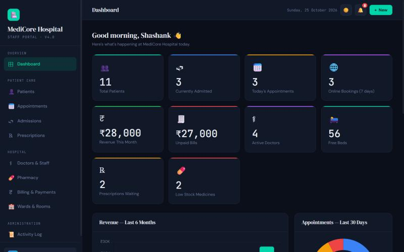 | 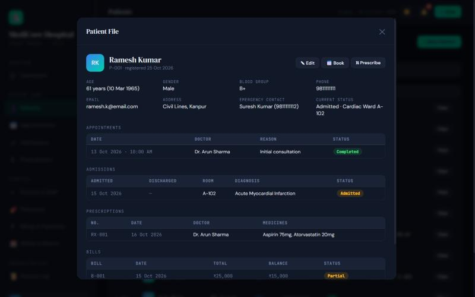 |
| **Appointments** (online bookings flagged) | **Wards and rooms** |
| 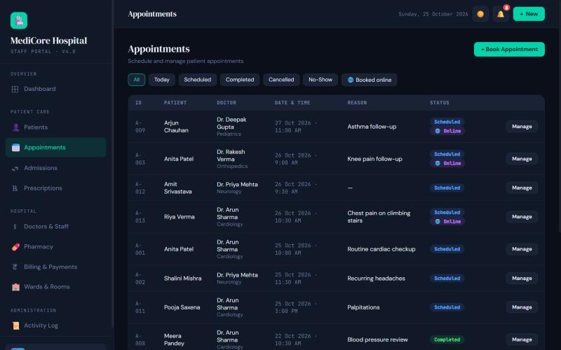 | 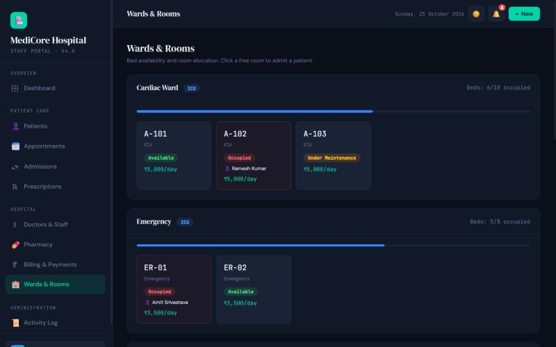 |

</details>

<details>
<summary><b>Patient portal</b></summary>
<br>

| Home | Online booking |
|---|---|
| 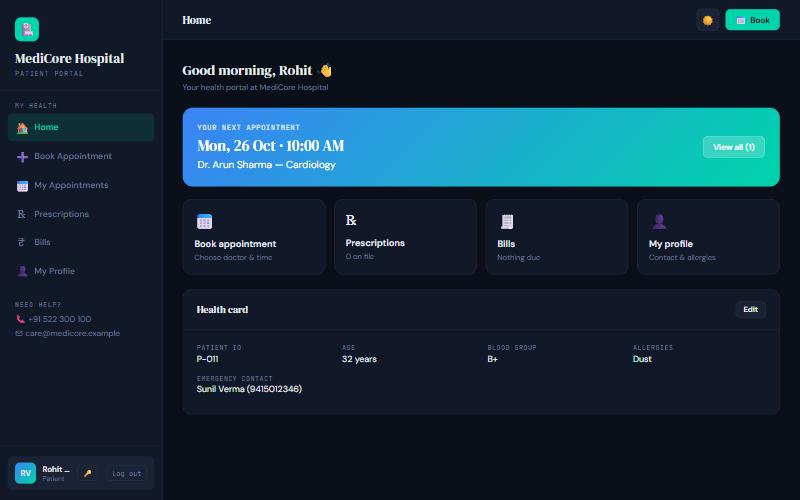 | 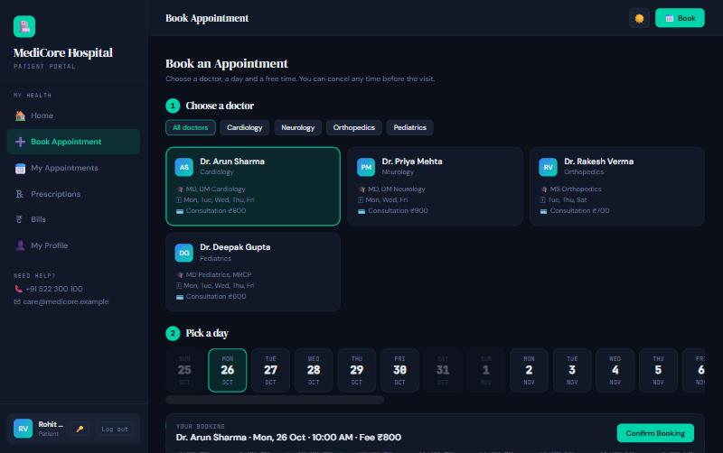 |

</details>

<details>
<summary><b>Sign-in, settings and activity log</b></summary>
<br>

| Sign in by role | Settings: passwords and accounts |
|---|---|
| 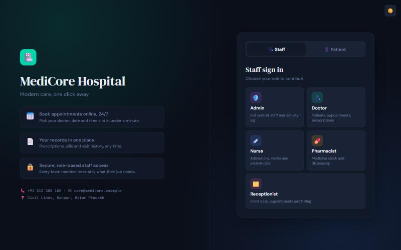 | 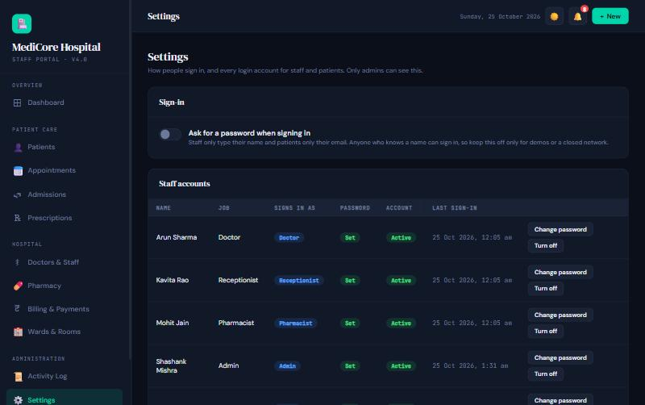 |
| **Activity log** | |
| 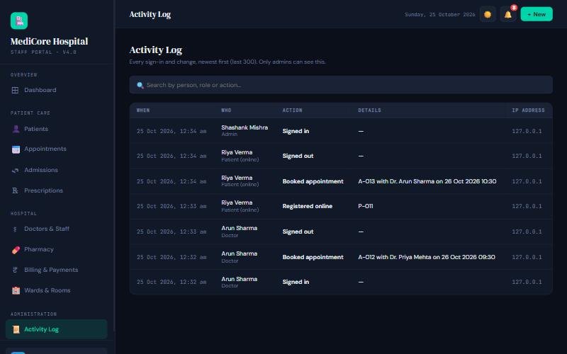 | |

</details>

## Quick start

> [!TIP]
> The fastest way to try it is Docker. You don't need Python or MySQL installed.

```bash
git clone https://github.com/shashankmishra23/medicore-hospital-management.git
cd medicore-hospital-management
docker compose up --build
```

Open **http://localhost:5000**, choose **Admin**, and sign in as **Shashank Mishra** with password `admin123`.

<details>
<summary><b>Run without Docker</b> (Python 3.10+ and MySQL 8)</summary>
<br>

```bash
git clone https://github.com/shashankmishra23/medicore-hospital-management.git
cd medicore-hospital-management
python -m venv .venv
.venv\Scripts\activate            # macOS / Linux: source .venv/bin/activate
pip install -r requirements.txt
```

Copy `.env.example` to `.env` and set at least `DB_PASSWORD` and `SECRET_KEY`. The `HOSPITAL_*` values set the name, address and phone shown in the app.

```bash
flask init-db       # creates hospital_db with sample data (drops it first if it exists)
python app.py
```

Open http://127.0.0.1:5000.

</details>

<details>
<summary><b>Sample accounts</b></summary>
<br>

Choose the role on the login page, then type the person's name (full or first name).

| Role | Name | Password |
|---|---|---|
| Admin | Shashank Mishra | `admin123` |
| Doctor | Arun Sharma | `doctor123` |
| Nurse | Sunita Singh | `nurse123` |
| Pharmacist | Mohit Jain | `pharma123` |
| Receptionist | Kavita Rao | `reception123` |
| Patient (portal) | `anita.p@email.com` | `patient123` |

</details>

> [!NOTE]
> An admin can switch off **Ask for a password when signing in** on the Settings page. The login pages then ask only for a name (staff) or email (patients), which is handy for demos on a closed network.

## Architecture

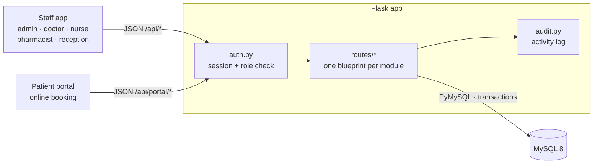

Both front ends are server-rendered pages with plain JavaScript that talk to a JSON API. Every request goes through one sign-in and permission check before it reaches a route.

<details>
<summary><b>How an online booking works</b> (sequence diagram)</summary>
<br>

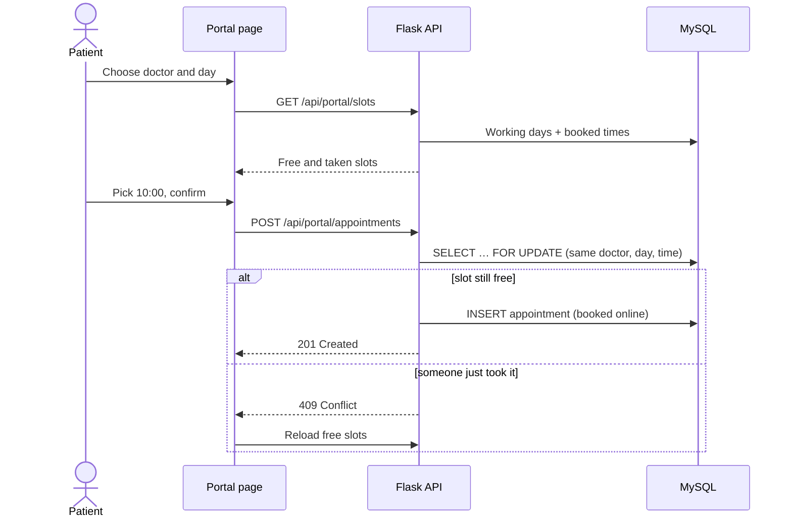

</details>

<details>
<summary><b>Database</b> (20 tables, 4 views; main relationships)</summary>
<br>

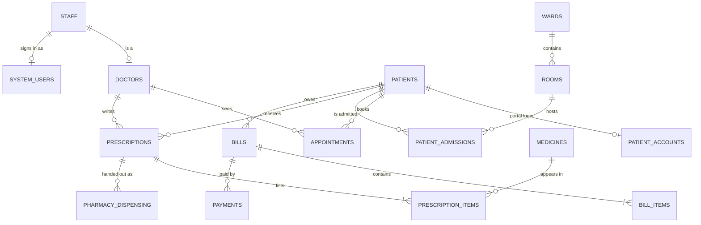

Full schema with sample data: [`database/schema.sql`](database/schema.sql)

</details>

### Built with

<p>
  
</p>

Flask (app factory, blueprints) · PyMySQL · MySQL 8 (foreign keys, views, generated columns, row locking) · plain JavaScript and CSS · Chart.js · gunicorn · pytest · ruff · GitHub Actions

## Design decisions

| Decision | Why |
|---|---|
| **Permissions live on the server** | Each route declares what it needs (`@requires("billing.write")`) and one `PERMISSIONS` table maps roles to actions. Hiding a button is convenience; the API is what refuses. |
| **Row locking for shared resources** | Admitting, dispensing and taking payments run in a transaction with `SELECT … FOR UPDATE`, so two people can't take the same bed, the same stock, or overpay the same bill. |
| **The server does the maths** | Bill totals, tax and discounts are calculated from the line items on the server; the page only shows a preview. |
| **Safe output by default** | Every page is built with a small tagged-template helper (`` html`…` ``) that escapes all values, so names and notes can't inject scripts. |
| **Patients can't take over records** | Online sign-up always creates a new record. Linking a portal account to an existing hospital record is done by an admin after an ID check. |
| **One connection per request** | Opened on first use, closed when the request ends; writes go through a `transaction()` helper that commits or rolls back as a whole. |
| **Everything is audited** | Sign-ins and every change are written to an activity log with user, role and IP address. |

<details>
<summary><b>What each role can do</b></summary>
<br>

| | Admin | Doctor | Nurse | Pharmacist | Receptionist |
|---|:-:|:-:|:-:|:-:|:-:|
| Patients | edit | edit | edit | view | edit |
| Appointments | edit | edit | view | | edit |
| Admissions | edit | edit | edit | | view |
| Prescriptions | edit | write | view | dispense | |
| Pharmacy stock | edit | view | | edit | |
| Billing | edit | | | | edit |
| Wards & rooms | edit | view | edit | | view |
| Staff | edit | | | | view |
| Settings & accounts | edit | | | | |
| Activity log | view | | | | |

</details>

## API reference

<details>
<summary><b>57 JSON endpoints</b>, the main ones listed here</summary>
<br>

Staff endpoints are under `/api` and need a staff session; patient endpoints are under `/api/portal` and need a patient session. Writes also check the user's role.

| Method | Endpoint | Purpose |
|---|---|---|
| `POST` | `/api/auth/login`, `/api/auth/logout` | Staff sign in / out |
| `GET` | `/api/dashboard`, `/api/dashboard/charts`, `/api/alerts` | Dashboard numbers, charts, alerts |
| `GET` `POST` | `/api/patients` | Search, register |
| `GET` `PUT` | `/api/patients/<id>` | Patient file, edit |
| `GET` `POST` | `/api/appointments` | List and filter, book |
| `GET` | `/api/appointments/slots` | Free slots for a doctor and day |
| `GET` `POST` | `/api/admissions` | List, admit |
| `POST` | `/api/admissions/<id>/discharge` | Discharge, optionally create the bill |
| `GET` `POST` | `/api/prescriptions` | List, write |
| `POST` | `/api/prescriptions/<id>/dispense` | Dispense and reduce stock |
| `GET` `POST` | `/api/medicines` | Stock, add medicine |
| `GET` `POST` | `/api/bills` · `POST /api/payments` | Bills and payments |
| `GET` `PUT` | `/api/settings`, `/api/settings/accounts` | Sign-in setting and accounts (admin) |
| `POST` | `/api/portal/register`, `/api/portal/login` | Patient sign up / sign in |
| `GET` `POST` | `/api/portal/slots`, `/api/portal/appointments` | Online booking |
| `GET` | `/health` | Health check for Docker and uptime monitors |

</details>

## Tests and CI

```bash
pip install -r requirements-dev.txt
ruff check .
pytest
```

The **40 tests** run against a real MySQL database (`hospital_db_test`, created and removed by the tests). They cover sign-in and lockout, role permissions, the password switch, booking rules, bed counts on admit and discharge, discharge bills, stock changes when dispensing, bill totals and payments, and patient data isolation.

GitHub Actions runs three jobs on every push and pull request:

| Job | What it checks |
|---|---|
| **Lint** | `ruff check .` |
| **Tests** | `pytest` against a MySQL 8 service |
| **Docker** | Builds the image, starts the stack, checks `/health` and the login page |

<details>
<summary><b>Project structure</b></summary>
<br>

```
app.py               app factory, /health, CLI commands (init-db, create-user)
config.py            settings from .env, including hospital branding
auth.py              sign-in, roles and permissions, password checks, lockout
audit.py             activity log
db.py, utils.py      database helpers, input validation, error handling
routes/              JSON API, one blueprint per module (patients, portal, settings, ...)
templates/           login.html, index.html (staff app), portal.html (patients)
static/js/           core.js (shared helpers) plus one file per page
static/css/          styles, dark and light theme
database/schema.sql  tables, views and sample data
tests/               pytest suite
Dockerfile, docker-compose.yml
```

</details>

## Roadmap

- [x] Role-based staff app with server-side permissions
- [x] Online patient portal with slot booking
- [x] Admissions with automatic discharge bills
- [x] Prescriptions, dispensing and stock control
- [x] Settings page and activity log
- [x] Docker setup and CI
- [ ] Email and SMS appointment reminders
- [ ] Online bill payment
- [ ] Lab test orders and results
- [ ] Reports exported to PDF and Excel

## Contributing

Issues and pull requests are welcome. Please read [CONTRIBUTING.md](CONTRIBUTING.md) first. For security problems, see [SECURITY.md](SECURITY.md).

<div align="center">
<br>

**If you found this project useful, consider giving it a ⭐**

Made by [Shashank Mishra](https://github.com/shashankmishra23) · [MIT License](LICENSE)

</div>
